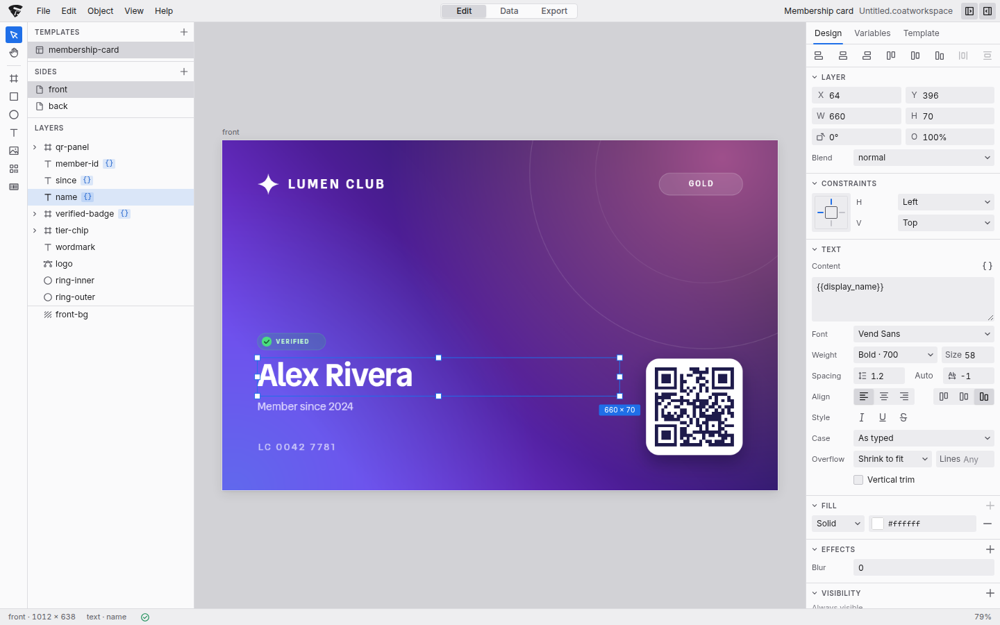
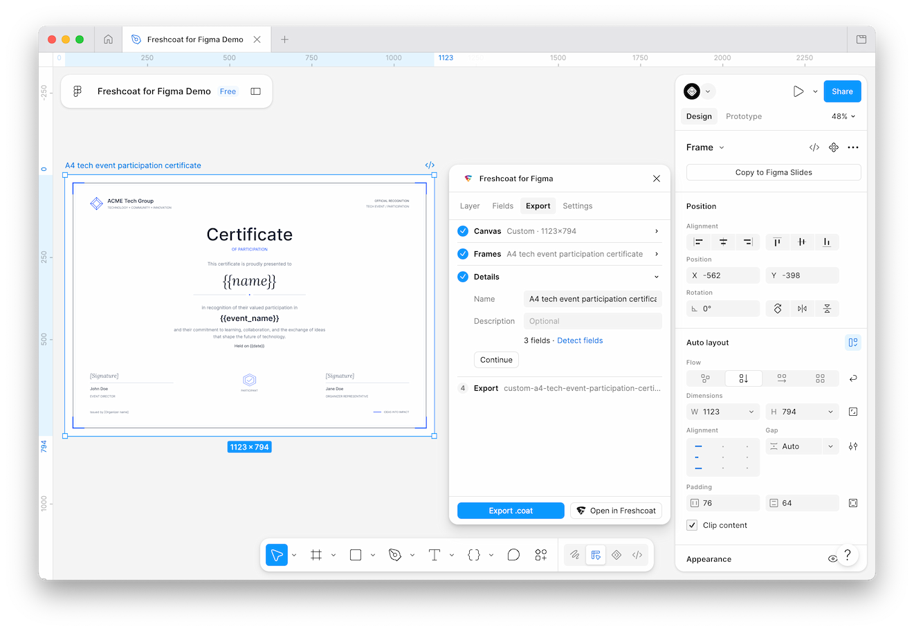

<h1>
  
</h1>

<p><strong>Create designs that scale.</strong></p>



Freshcoat is an open-source, end-to-end design tool for producing print designs
in batches. Create a design, add template placeholders, and generate an output
for each record in your dataset. Perfect for creating cards, badges,
certificates, and even watermarking images!

Freshcoat uses portable [template](packages/coatfile/) and
[workspace](packages/workspace/) formats. You can design and export in
[Studio](https://freshcoat.dotsidestudios.com), work from the
[command line](packages/cli/), or use the packages in your own application.

## What Freshcoat is for

Freshcoat is built around reusable designs and batch production. Its editing
features are more focused than those of tools like Figma, Canva, or Adobe's
design apps, which helps keep designs portable across Freshcoat's tools.

You can use it for other kinds of design work too, and we'd love to see what
you make with it!

## Why we're open sourcing it

We originally built Freshcoat for [Davi](https://shop.davi.social)'s card
production pipeline after struggling to find a tool that fit our needs. We're
sharing it so others can build on it and adapt it to their own workflows. We
also want the format and the code that interprets it to be open and
understandable.

We're not experts in graphics engines or compiler design, and most of the work
on Freshcoat has been AI-assisted. Our decisions draw on our experience with
compilers, existing design tools, Canvas2D image generation, and producing
designs at scale. There's still plenty for us to learn.

We'd welcome help finding mistakes, questioning assumptions, and improving
Freshcoat's components. If that sounds like your kind of work, see the
[contribution guide](CONTRIBUTING.md).

## Getting started

Whether you're designing cards or building an application, here's where to
start.

| If you want to | Start with |
|---|---|
| Try creating and exporting designs yourself | [Freshcoat Studio](https://freshcoat.dotsidestudios.com) |
| Turn your existing Figma designs into templates | [Freshcoat for Figma plugin](#figma-plugin) |
| Render templates from a terminal or your CI | [Freshcoat CLI](#cli) |
| Render templates in your own applications | [Freshcoat Coatfile SDK](#sdk) |
| Prepare images for card printers | [Freshcoat for Print SDK](packages/for-print/) |
| Bind datasets to templates and batch-export them to ZIPs or PDFs | [Freshcoat Workspace SDK](packages/workspace/) |
| Build your own template format on a 2D renderer | [Freshcoat Engine](packages/engine/) |

## Quick start

### CLI

> The CLI and its packages require Node 22 or later or Bun 1.3.13 or later.
> On Node 22, npm may show an `EBADENGINE` warning for `hucre`, the spreadsheet
> dependency, which declares Node 24. Spreadsheet import and export work on
> Node 22, so the warning is safe to ignore.

From a terminal, install the command line and render a template. To try it
without a template of your own, download
[`minimal-card.json`](packages/coatfile/fixtures/minimal-card.json) and
[`people.csv`](packages/coatfile/fixtures/people.csv) into your working
directory:

```sh
# Install the CLI package
npm install --global @freshcoat-js/cli

# Render a card with "Alex" as its display name to `out`
freshcoat render minimal-card.json --set displayName="Alex" --out out

# Render a card for each row in a CSV with a `displayName` column
freshcoat render minimal-card.json --data people.csv --out cards.zip
```

See the [CLI README](packages/cli/README.md) for more details.

### SDK

Using the same [`minimal-card.json`](packages/coatfile/fixtures/minimal-card.json)
template, install the Coatfile SDK and engine packages:

```sh
npm install @freshcoat-js/coatfile @freshcoat-js/engine
```

```ts
import { readFile, writeFile } from "node:fs/promises";
import { loadTemplate } from "@freshcoat-js/coatfile";
import { renderTemplate } from "@freshcoat-js/coatfile/render";
import { createRenderer } from "@freshcoat-js/engine";
import { loadCanvasKit } from "@freshcoat-js/engine/node";

const loaded = await loadTemplate(await readFile("minimal-card.json"));
if (!loaded.ok) throw new Error("Could not read minimal-card.json");

const renderer = await createRenderer({ ck: await loadCanvasKit() });
const [front] = await renderTemplate(renderer, loaded.template, { displayName: "Alex" });
await writeFile("front.png", front.bytes);
```

Create the renderer once and reuse it. See the
[Coatfile SDK README](packages/coatfile/README.md) for variants, export sizes and
batch rendering.

## Figma plugin

To make it easier to use your existing Figma designs in Freshcoat, we provide a
[Figma plugin](https://www.figma.com/community/plugin/1685967766479998641)
that lets you export them as Freshcoat templates.



## Develop

Requires [Bun](https://bun.sh) 1.3.13 or later. From the repository root:

```sh
bun install
bun run test
bun run typecheck
```

Each app and package has its own README with development commands.
For example, `bun run --cwd apps/editor dev` starts Studio, while
`bun run --cwd apps/figma-plugin build` builds the plugin.
The root `dev` and `build` aliases target Studio for convenience.

To run the CLI from source, call its entry with Bun:

```sh
bun packages/cli/src/bin.ts render card.coat --out out
```

Release builds for the SDK packages and the command line include compiled ESM,
TypeScript declarations and assets. Their source manifests are private and
intended for workspace development; use the generated tarballs for publication.
See the [release guide](docs/releases.md) for npm setup, release checks and
Figma plugin bundles.

## Documentation

- [Architecture](ARCHITECTURE.md): package responsibilities and host boundaries.
- [Contributing](CONTRIBUTING.md): repository setup, checks and review conventions.
- [Upgrading from 0.4](docs/migrating-to-0.5.md): what changed in 0.5 and how to move over.
- [Upgrading from 0.3](docs/migrating-to-0.4.md): what changed in 0.4 and how to move over.
- [Releases](docs/releases.md): npm publication and Figma release bundles.
- [CLI](packages/cli/README.md), [Studio](apps/editor/README.md) and
  [Figma plugin](apps/figma-plugin/README.md): commands, behavior and guides
  for each tool.
- Each package README documents its API, runtime requirements and examples.

## License

Freshcoat is licensed under the [Apache License 2.0](LICENSE). Copyright 2026
Dotside Studios; see [NOTICE](NOTICE) and
[third-party notices](THIRD_PARTY_NOTICES.md).
The name and marks are not licensed; see [NAMES-AND-LOGOS.md](NAMES-AND-LOGOS.md).
